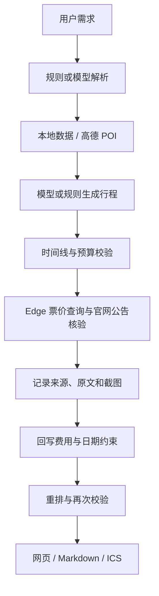

# 旅游规划器 · Travel Planner

一个本地运行的旅游规划工具：将自然语言需求转换为每日行程，通过代码校验时间线与预算，并使用 **browser-use 驱动 Edge** 查询票价、核验官网公告，保留来源链接和网页截图。

支持离线演示、Ollama 本地模型、高德 POI 与路径规划、聊天式网页、Markdown 报告和 ICS 日历导出。

> 当前为个人项目演示版本。浏览器核验主要在 Windows + Edge 环境联调；搜索结果可能过期或匹配错误，票价与开放状态请以景区最新公告为准。

## 功能

- **需求解析**：识别城市、日期、天数、总预算和偏好；未指定日期时使用电脑当地日期，明确日期优先。
- **行程生成**：Ollama 负责候选景点选择和分天安排；模型不可用时尝试规则规划。
- **代码校验**：推演时间线，检查开放时间窗、闭馆日、重复景点、必去约束和已知费用。
- **浏览器查价**：在真实 Edge 中定位搜索框、输入完整中文查询、回车提交，等待首栏结果稳定后提取成人票或免费信息。
- **来源与证据**：展示查询网址、原文、采集时间和截图，区分官网实查、搜索参考与待核实信息。
- **反馈重排**：结合校验问题和适用的闭馆约束调整行程，保留用户明确预算。
- **结果导出**：下载 Markdown 行程和可导入日历的 `.ics` 文件。

## 快速开始

推荐 **Python 3.12 或 3.13**。请从源码目录运行，当前安装与说明主要面向源码检出后的本地使用。

### 1. 创建虚拟环境

下载仓库后，在项目根目录打开终端：

```powershell
python -m venv .venv
.venv\Scripts\Activate.ps1
python -m pip install --upgrade pip
python -m pip install -e .
```

如果 PowerShell 不允许激活脚本，可直接使用 `.venv\Scripts\python.exe` 替代后续命令中的 `python`。

macOS / Linux 激活环境使用 `source .venv/bin/activate`。核心离线流程不需要第三方运行依赖；浏览器核验需要另装可选依赖。

### 2. 先运行离线示例

```powershell
python -m travel_planner --offline "成都两天，预算500，喜欢人文"
```

离线模式不调用模型、不联网，使用仓库中的本地城市数据。数据中的默认票价和开放时间不代表实时核实结果。

### 3. 启动网页

```powershell
python -m travel_planner.web
```

浏览器自动打开本地页面，默认地址为 `http://127.0.0.1:8777/`；端口占用时以终端打印的实际地址为准。无配置体验时选择“离线”，并关闭官网核验。

Windows 也可双击 `启动网页版.cmd`，它优先使用项目 `.venv`。

```powershell
python -m travel_planner.web --port 8888 --no-browser
```

## 端口与服务地址配置

**首次运行通常无需手动配置端口。** 网页服务默认使用 `8777`，Ollama 默认连接 `11434`，Edge 由程序自动分配空闲调试端口。高德使用在线 HTTPS 接口，无需填写本地端口。

| 服务 | 默认地址 / 端口 | 用户在哪里修改 | 何时需要修改 |
| --- | --- | --- | --- |
| 旅游规划器网页 | `http://127.0.0.1:8777` | 启动命令加 `--port 8888`，或运行 `启动网页版.cmd --port 8888` | 想固定网页端口，或默认端口被占用 |
| Ollama 模型服务 | `http://127.0.0.1:11434` | 网页设置中的 Ollama 地址，或 `.env` 中的 `OLLAMA_HOST` | Ollama 使用了其他端口或部署在其他机器 |
| Edge 浏览器调试连接 | 程序自动分配，无需填写 | 仅连接自己启动的调试会话时设置 `.env` 中的 `BROWSER_USE_CDP_URL` | 已有独立的 Edge 调试会话需要复用 |

### 修改网页端口

先停止自己启动的旧服务，再从项目根目录启动：

```powershell
python -m travel_planner.web --port 8888
# Windows 启动脚本也接受相同参数：
.\启动网页版.cmd --port 8888
```

随后访问 `http://127.0.0.1:8888/`。如果指定端口仍被占用，程序会尝试后续端口，**以终端打印的实际地址为准**。网页端口在服务启动前决定，目前通过启动参数修改，不在运行中的网页设置里修改。

### 修改 Ollama 地址

网页设置中的 Ollama 地址需要填写完整地址，例如 `http://127.0.0.1:11435`。也可在 `.env` 中配置：

```dotenv
OLLAMA_HOST=http://127.0.0.1:11435
```

这会改变旅游规划器连接模型的目标地址，**不会自动改变 Ollama 服务自身监听的端口**。需先让 Ollama 在相应地址提供服务，再填写一致的地址。若连接其他机器，使用该机器的实际地址；此配置不改变旅游规划器网页仅在本机监听的行为。

### Edge 调试端口一般无需配置

正常查询时由程序自动启动独立 Edge、分配端口并管理会话。`.env.example` 中的 `BROWSER_USE_CDP_URL` 默认保持注释即可。

只有已经自行启动独立调试会话时，才填写它的实际地址，例如：

```dotenv
BROWSER_USE_CDP_URL=http://127.0.0.1:9222
```

`9222` 只是示例，不是必须开放的端口；仅填写这个值不会启动调试会话。该方式会连接指定浏览器，建议使用独立临时配置，不要使用个人日常登录的浏览器配置。使用 `.env` 修改这些配置后重启旅游规划器；如果系统中已设置同名环境变量，则环境变量优先。

## 启用完整流程

### 配置高德和 Ollama

```powershell
Copy-Item .env.example .env
```

编辑 `.env`：

```dotenv
AMAP_KEY=你的高德Web服务Key
OLLAMA_HOST=http://127.0.0.1:11434
TRAVEL_MODEL=qwen3:8b
TRAVEL_BROWSER_HEADLESS=1
```

安装并启动 [Ollama](https://ollama.com/)，下载与你电脑性能匹配的模型，例如：

```powershell
ollama pull qwen3:8b
```

高德 Key 在 [高德开放平台](https://lbs.amap.com/) 申请。网页设置也支持写入 Key、模型名和 Ollama 地址。环境变量优先于 `.env`；配置变更后建议重启服务。

### 安装 browser-use

```powershell
python -m pip install -e ".[browser]"
python -m travel_planner.runtime
```

本项目按实际联调版本固定 `browser-use==0.13.14`。默认使用当前 Python 运行浏览器工作进程，无需复制开发者电脑的 browser-use 目录。

Windows 需已安装 Microsoft Edge，默认位置为：

```text
C:/Program Files (x86)/Microsoft/Edge/Application/msedge.exe
```

路径不同可在 `.env` 设置 `BROWSER_USE_EXECUTABLE`。如果依赖安装在另一个环境，设置 `BROWSER_USE_PY` 为该环境的 Python 路径。依赖检查命令只检查本地配置，不证明联网查询成功。

默认使用独立、无窗口的 Edge 会话和临时用户目录；要观察查询过程，设置 `TRAVEL_BROWSER_HEADLESS=0`。无需管理员身份，不使用个人浏览器登录配置。也可设置 `BROWSER_USE_CDP_URL` 连接自己明确启动的独立调试会话。

网页生成时启用官网核验，即可运行网页取证流程。常规票价与公告核验直接使用 browser-use 页面接口，不需要云端模型 Key；旧的 `--fetch browser` 数据采集入口是另一条模型辅助采集流程，不是网页核验的必要步骤。

## 架构与数据流



| 目录 / 模块 | 职责 |
| --- | --- |
| `travel_planner/intent.py`、`travel_dates.py` | 需求和出游日期解析 |
| `agent_planner.py`、`planner.py` | 模型编排与规则规划 |
| `simulator.py`、`budget.py`、`pricing.py` | 时间线、预算与票价规则 |
| `browser_review.py`、`workers/` | 浏览器调用、官网核验和证据采集 |
| `amap.py`、`routes.py` | POI、路线与交通估算 |
| `web.py`、`webui/` | 本地 HTTP 服务和网页 |
| `data/`、`official_sources.json` | 本地数据与优先官网入口 |
| `tests/` | 离线回归测试及受控样例 |

项目没有采用 LangChain / LangGraph；模型编排、规则校验和反馈循环使用 Python 实现。网页服务基于 Python 标准库，浏览器任务通过独立工作进程执行。

## 票价、预算和公告如何解释

- 按 **1 名普通成人**计算门票、餐饮和市内交通；住宿、城际交通和附加项目不计入。
- 餐饮 **120 元/天**、市内交通 **30 元/天**属于显式估算，并非实际报价。因此 200 元预算也可能无法满足多日行程，程序应报告不足，不能提高用户预算。
- 搜索参考价可计入费用小计，但不等于官网确认；存在未知或待核实项目时，不显示确定结余、不声称完整预算通过。
- 首栏仍在“正在思考 / 搜索”时不会当成无票价；超时、验证页和无关结果会保留失败原因。
- 同名景点、旧年份、促销、优惠票和附加项目仍可能造成错误或缺失，当前不能承诺任意景点都取得准确价格。
- 未发现闭馆公告不等于确认开放；局部关闭、模糊日期和无法确认归属的信息只提示。
- 官网核验数量与任务时间有限；未完成的景点保持待核实。不会执行登录、预约提交或购票。

## 测试与自检

```powershell
python -m unittest discover -s tests -q
python -m travel_planner.runtime
```

GitHub Actions 配置在 Windows / Ubuntu、Python 3.12 / 3.13 运行离线回归测试。浏览器真实联网结果受站点变化影响，不纳入自动测试的成功承诺。Windows Edge 是主要联调环境，其他平台的浏览器流程尚未完成验证。

## 常见问题

| 现象 | 处理 |
| --- | --- |
| 没有高德 Key | 使用离线已有城市；需要自动取 POI 时再配置 |
| Ollama 连接失败 | 确认服务、模型名和地址；无模型时规则规划能力有限 |
| `No module named browser_use` | 在实际工作进程的 Python 环境安装 `.[browser]` |
| 找不到 Edge | 设置 `BROWSER_USE_EXECUTABLE` |
| 票价待核实 | 查看原文、截图与失败原因，必要时人工核对 |
| 改代码后页面没有变化 | 检查终端地址和页面构建号，关闭自己启动的旧服务再重启 |
| 想查看实际浏览器操作 | 设置 `TRAVEL_BROWSER_HEADLESS=0` 后重启 |

## 数据、隐私与发布说明

本地 JSON 包含开发期间采集的景点数据及来源字段，供演示和测试；不是官方实时数据库。使用高德或第三方网站时需遵守相应服务条款，网页、图片和数据权益属于各自权利人。

`.env`、缓存、日志、生成报告、浏览器配置和临时测试目录均排除在版本控制之外。请勿将真实 Key、个人行程或登录数据提交到仓库。

服务仅供本机使用，包含本地设置和文件输出功能，没有面向公网的鉴权、配额与运维设计。当前不适合直接暴露到公网。

## 后续改进

- 更严格地结合城市、地址和 POI 身份处理同名景点。
- 增加预算项目配置、价格冲突解释和多人数支持。
- 提升浏览器任务取消、进度与失败恢复体验。
- 完善跨平台浏览器兼容性及真实网站验收样例。

## 许可

本发布整理版本尚未选择开源许可证，未授予额外的开源使用许可。公开发布前，作者可按自己的授权意愿添加 LICENSE；第三方依赖与数据遵循各自许可和条款。
